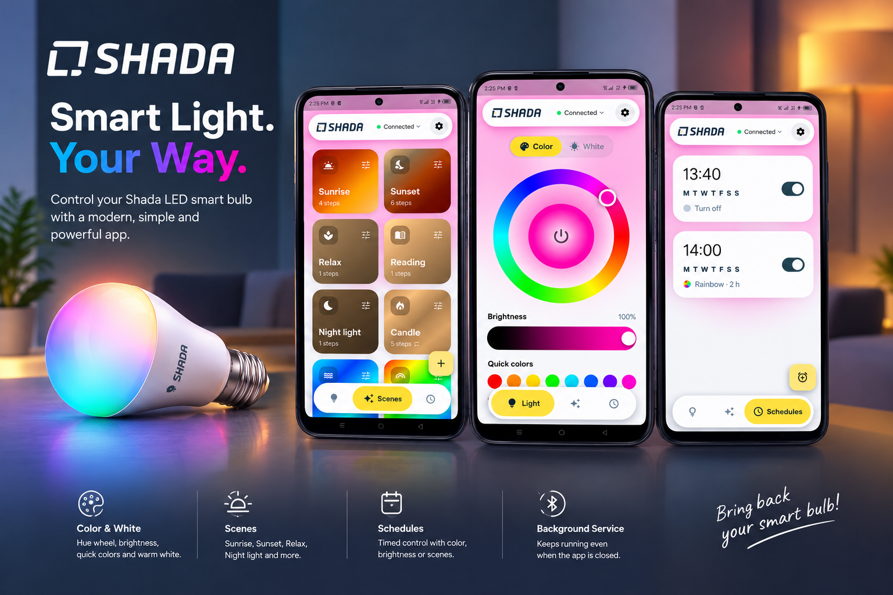
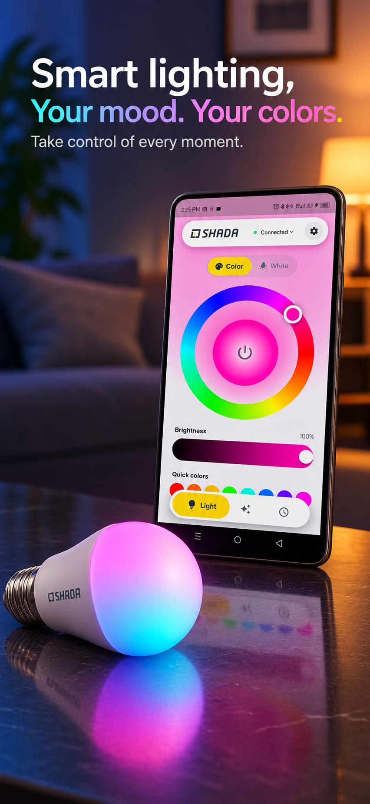
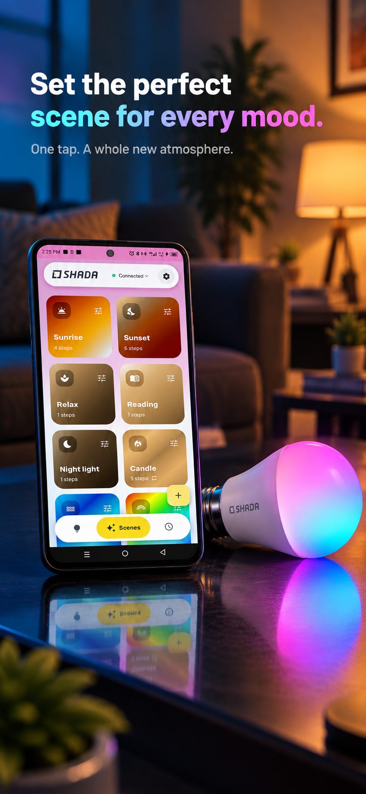
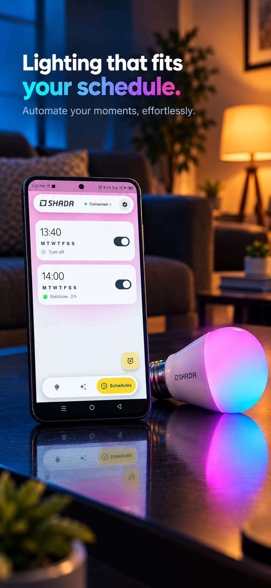

# Shada LED Light



A modern Flutter app that brings the **Shada LED's light Bluetooth smart bulb** back to life after the original app was removed from the Play Store.

> **Unofficial app.** Not affiliated with, endorsed by or supported by Shada B.V. "Shada" and its logo belong to their owner and are used here only to identify the compatible product.

<p align="center">
  
  
  
</p>

## Download


**[Download the latest APK](https://github.com/mohamedbnhmida/Shada-Led-s-Light/releases/latest/download/ShadaLEDLight.apk)** (Android 7.0+), or scan the QR code with your phone.

Installing an APK outside the Play Store requires allowing "Install unknown apps" for your browser or file manager.

<br clear="right" />

## Supported model

| Product | Art. no. | Bulb | Connectivity |
|---|---|---|---|
| Shada LED's light smart bulb | **600750** | E27, 6 W, 470 lm, 2700 K warm white + RGB | Bluetooth 4.0 (BLE) |

Other bulbs sold with the original *LED's light* app (`com.shada.ledslight`) that advertise the same Bluetooth service will probably work too, but only the 600750 has been tested.

## Features

- **Color & white**: hue wheel, brightness, quick colors, and warm-white mode (the 600750 has 2700 K LEDs only, no cold white).
- **Scenes**: Sunrise, Sunset, Relax, Reading, Night light, Candle, Ocean, Rainbow and Party, plus your own: each step holds or fades to a color, optionally looping.
- **Schedules**: turn on with a chosen color/brightness, turn off, or play a scene at a time and on chosen days, for a set duration (15 min to 12 h) before the lamp switches off.
- **Runs in the background**: scenes and schedules are played by an Android foreground service, so they keep going with the app closed or the phone locked, and survive reboots and updates.
- **Gentle Bluetooth reminder**: if Bluetooth stays off for 30 minutes while something is scheduled, one quiet notification (at most every 12 hours).
- **Remembers your lamp** and reconnects automatically.
- **English, French and Arabic** (with right-to-left layout), **light and dark** themes.

## How it works

The original app was decompiled to recover the bulb's protocol. The bulb uses a Quintic BLE chip and needs no pairing or encryption:

| Step | Detail |
|---|---|
| Discover | Bulb advertises service `ffffcc02-…` or `0000cc02-…` |
| Unlock | After connecting, write ASCII `quintic` to characteristic `0000ee02` |
| Control | Write 10 bytes to `0000ee03` (write without response) |
| State | Notifications on `0000ee01`, same 10-byte layout |

Packet layout: `[on, G, white, cold, on, B, on, R, white, warm]`. Color mode sets the three `on` bytes to 1; white mode sets both `white` bytes to 1 and drives `warm`. There is no brightness byte, so brightness scales the RGB values. See [`lib/protocol.dart`](lib/protocol.dart).

## Build

```bash
flutter pub get
flutter run                 # debug on a connected phone
flutter build apk --release # build/app/outputs/flutter-apk/app-release.apk
flutter test                # protocol, scenes and scheduling tests
```

Requires Flutter 3.44+ and a phone with Bluetooth LE. Schedules and background scenes use an Android foreground service; on iOS only foreground control is supported.

## Tech

Flutter · flutter_blue_plus (BLE) · flutter_foreground_task (background service) · flutter_local_notifications · shared_preferences · Material 3

## License

Personal, non-commercial project. `flutter_blue_plus` is used under its free license for non-profit use.
